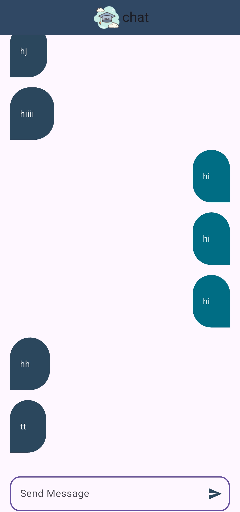

# Scholar Chat

A real-time chat app built with Flutter and Firebase. Create an account, log in, and send messages that appear instantly for everyone in the chat room.

## Features

- **Sign up and log in:** email and password authentication with Firebase Authentication.
- **Real-time messaging:** messages are stored in Cloud Firestore and appear instantly, without refreshing.
- **Chat bubbles:** your messages and other users' messages have different colors and sides.
- **Loading and error feedback:** a loading overlay while signing in, and clear messages for errors such as a wrong password or an email already in use.
- **Form validation:** empty fields are checked before submitting.


## Screenshots

  

## Tech stack

| Area | Tools |
| --- | --- |
| Framework | Flutter, Dart |
| State management | `flutter_bloc` (Bloc for authentication, Cubit for chat) |
| Authentication | `firebase_auth` |
| Database | `cloud_firestore` |
| Backend setup | `firebase_core` |
| UI | `modal_progress_hud_nsn` |

## Project structure

```
lib/
├── bloc/        # Authentication Bloc (events and states)
├── cubits/      # Chat Cubit (send and listen to messages)
├── models/      # Message model
├── pages/       # Login, register and chat screens
├── widgets/     # Reusable widgets (chat bubble, button, text field)
├── helper/      # Snack bar and Bloc observer
└── main.dart
```

## Getting started

This app needs its own Firebase project.

1. Install [Flutter](https://docs.flutter.dev/get-started/install) and the [FlutterFire CLI](https://firebase.google.com/docs/flutter/setup).
2. Create a project in the [Firebase console](https://console.firebase.google.com), then enable **Email/Password** sign-in under Authentication and create a **Cloud Firestore** database.
3. Clone the repository:
   ```bash
   git clone https://github.com/ZAIN-Zaug/scholar-chat.git
   cd scholar-chat
   ```
4. Connect the app to your Firebase project (this regenerates `lib/firebase_options.dart`):
   ```bash
   flutterfire configure
   ```
5. Install the dependencies and run:
   ```bash
   flutter pub get
   flutter run
   ```

## Author

**Zain Ahmad Issa** — [GitHub](https://github.com/ZAIN-Zaug)
